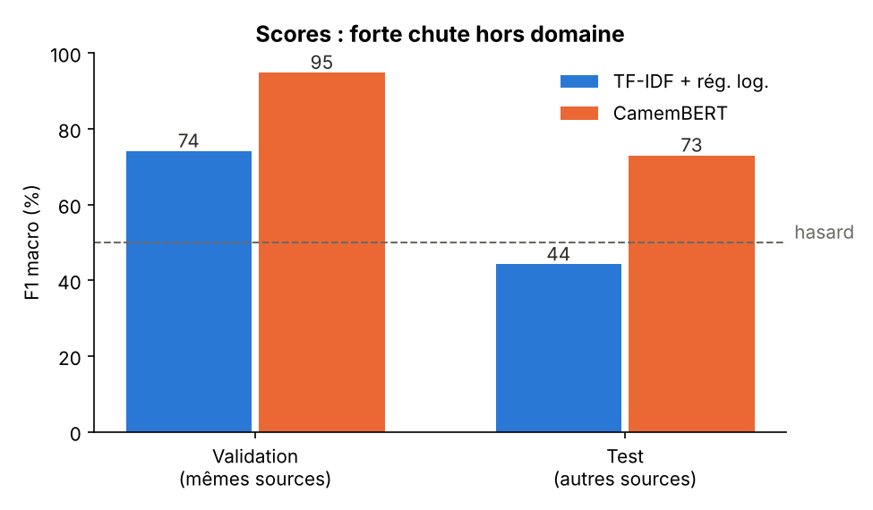
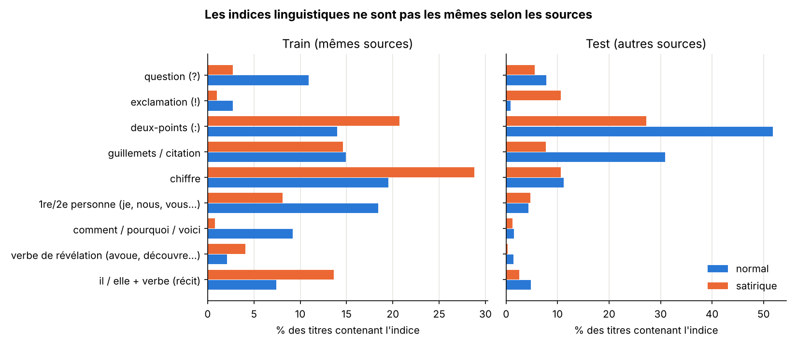

# Détection de satire dans les titres de presse français

Classifieur **CamemBERT** qui distingue les titres satiriques (type *Le Gorafi*) des titres de presse classiques, comparé à une baseline TF-IDF.
Le modèle apprend-il vraiment la satire, ou seulement le style et l'époque de certains journaux ? Une **analyse linguistique des erreurs** cherche à répondre à cette question.

> Projet personnel, Master 2 Langue et Informatique (TAL), Sorbonne Université.

## Résultats

| Modèle | Validation (mêmes sources) | Test (autres sources) |
|---|:---:|:---:|
| TF-IDF + régression logistique | 78,6 % acc. / 74,1 F1 | 44,2 % acc. / 44,2 F1 |
| **CamemBERT (fine-tuné)** | **95,4 % acc. / 94,8 F1** | **75,6 % acc. / 73,0 F1** |



**À retenir :** les deux modèles sont très bons sur des titres qui viennent des mêmes sites que l'entraînement. Ils chutent sur le test, où les titres viennent d'autres sites et d'autres périodes.
La baseline tombe même **sous le hasard**, ce qui montre qu'elle a appris des indices propres aux sources plutôt que la satire elle-même. CamemBERT généralise mieux (+29 points de F1), mais il reste loin de ses 95 %.

## Données

[**FreSaDa**](https://github.com/adrianchifu/FreSaDa) (Ionescu & Chifu, 2021) contient des titres d'articles satiriques et normaux. Le jeu de test vient de **sources différentes** de celles du train, c'est donc une évaluation *cross-domain*.

Prétraitement :
- **Suppression des doublons** : le train passe de 8 716 à 6 730 titres et le test de 2 854 à 2 350. Un même titre apparaissait jusqu'à 148 fois dans le test, ce qui aurait faussé les scores.
- Split : train 6 057, validation 673 (10 % du train, stratifié) et test 2 350.
- Labels : 1 = satirique, 0 = normal.

## Analyse linguistique

### 1. Les indices de la satire changent selon les sources



- **Dans le train**, les titres normaux ressemblent à du *clickbait* (« comment », « pourquoi », « voici », questions, 1re et 2e personne : *« 8 astuces pour préparer la rentrée »*). Les titres satiriques imitent la **dépêche factuelle** à la 3e personne avec des verbes de révélation (*« Vivendi rachète 30 % de Dieu »*, *« il découvre que… »*).
- **Dans le test**, c'est presque l'inverse. Les titres normaux sont des dépêches politiques avec **deux-points et citation** (52 % contiennent « : », 31 % des guillemets). Les titres satiriques sont **courts** (6,4 mots en moyenne contre 13,4 dans le train) et utilisent davantage le **point d'exclamation** (10,6 % contre 1 %).

On retrouve ce que dit la linguistique de la satire : elle **imite le genre** qu'elle parodie. Ses marques de surface dépendent donc du style de la source imitée, et un modèle qui s'appuie sur ces marques généralise mal.

### 2. Les mots appris par la baseline sont surtout des indices d'époque

Mots les plus associés à chaque classe (régression logistique) :
- satirique : *horoscope, gorafi, découvre, avoue, désormais, ump, françois…*
- normal : *comment, pourquoi, voici, trump, macron, fillon, hamon, 2017…*

Ici « UMP » et « François (Hollande) » signalent la période 2012-2014 des titres satiriques, et « Macron » ou « 2017 » celle des titres normaux. Le modèle a donc en partie appris **une date**, pas la satire.

### 3. Les erreurs de CamemBERT sur le test

Matrice de confusion (test) :

| | prédit normal | prédit satirique |
|---|:---:|:---:|
| **vrai normal** | 1 254 | 172 |
| **vrai satirique** | 402 | 522 |

→ Le modèle est **prudent** : il rate surtout des titres satiriques (402 sur 924), et accuse rarement à tort un vrai titre (172 sur 1 426).

**Faux positifs (titres réels jugés satiriques à plus de 99 %)** :
- *« Royal favorable au retour des coupures d'eau pour les mauvais payeurs »*
- *« L'UMP lance une pétition pour soutenir un boulanger des Landes »*
- *« 2012 : François Hollande s'adresse aux ouvriers »*

→ Ce sont des titres politiques des années 2012-2013, la même période que la satire du train. Certains sont aussi réellement **absurdes**, et rien dans le texte seul ne permet de savoir qu'ils sont vrais : il faudrait des **connaissances du monde**.

**Faux négatifs (titres satiriques ratés)** :
- *« Chômage : Hollande a la solution »*
- *« La solidarité est toujours un délit »*
- *« Yémen, une guerre ignorée »*

→ Ce sont des titres courts, au ton éditorial, sans scénario absurde. L'ironie y est **implicite** et dépend du contexte (on sait que la phrase est ironique seulement si on connaît la situation).

Taux d'erreur selon les indices (test) : les titres avec citation entre guillemets sont très bien classés (2,5 % d'erreur contre 30,5 % sans). À l'inverse, ceux qui contiennent un « ! » sont souvent mal classés (43 % d'erreur contre 23,5 %).

## Limites

- Il s'agit de **satire journalistique** (titres d'articles), pas de sarcasme conversationnel (tweets, dialogues). Les deux phénomènes sont proches mais pas identiques.
- Les titres seuls ne suffisent pas toujours : sans connaissances du monde ni contexte, certains titres réels et absurdes sont indiscernables de la satire.
- Les titres du dataset datent surtout des années 2010 : le modèle sera moins fiable sur l'actualité récente.

## Pistes d'amélioration

- Masquer les entités nommées (personnalités, partis, dates) pour forcer le modèle à apprendre le style plutôt que l'époque.
- Entraîner sur plusieurs sources à la fois (*multi-domain*).
- Ajouter le texte de l'article (disponible dans FreSaDa) et pas seulement le titre.

## Utilisation

```bash
pip install -r requirements.txt
bash scripts/download_data.sh          # télécharge FreSaDa dans data/

python src/prepare_data.py             # nettoyage + split
python src/baseline.py                 # baseline TF-IDF
python src/train_camembert.py          # fine-tuning (~25 min sur CPU, quelques min sur GPU)
python src/analyse.py                  # analyse linguistique + figures

python src/predict.py "Le Sénat vote la suppression des lundis"
python app.py                          # démo Gradio
```

Le modèle (440 Mo) est trop lourd pour GitHub. Pour le publier sur le Hugging Face Hub :
```bash
huggingface-cli login
huggingface-cli upload <ton-pseudo>/camembert-satire-fr models/camembert-satire
```

Entraînement : `camembert-base`, 2 epochs, learning rate 2e-5, batch 16, longueur max 64 tokens.

## Structure

```
├── src/
│   ├── prepare_data.py      # nettoyage, doublons, split
│   ├── baseline.py          # TF-IDF + régression logistique
│   ├── train_camembert.py   # fine-tuning CamemBERT
│   ├── analyse.py           # indices linguistiques + analyse d'erreurs
│   └── predict.py           # prédiction sur une phrase
├── app.py                   # démo Gradio
├── scripts/download_data.sh
└── results/                 # scores, prédictions, figures
```

## Références

- R. T. Ionescu, A. G. Chifu. *FreSaDa: A French Satire Data Set for Cross-Domain Satire Detection.* IJCNN 2021. [arXiv:2104.04828](https://arxiv.org/abs/2104.04828)
- L. Martin et al. *CamemBERT: a Tasty French Language Model.* ACL 2020.

## Licence

Code : MIT. Les données FreSaDa et le modèle entraîné dessus sont sous **CC BY-NC-SA 4.0** (usage non commercial), comme le dataset d'origine.

**Auteure :** Sara Hadidi · [GitHub](https://github.com/had98idi-tech)
